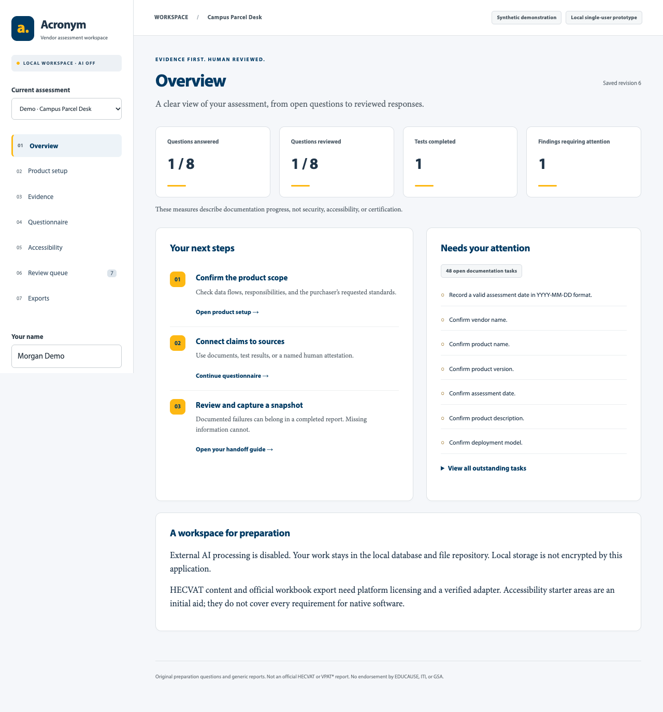

# Acronym

Acronym helps small software vendors prepare security questionnaires and accessibility reports for college and university purchasers. It explains unfamiliar questions, organizes evidence and testing results, and guides users through human review. Users leave with an editable preparation package and clear next steps for completing the requested HECVAT and VPAT-based documents.

**Open the app:** [Acronym vendor workspace](https://app-acronym-cmw2fde0.azurewebsites.net). Public source: [csludlow/Acronym](https://github.com/csludlow/Acronym).

**Working prototype:** React and TypeScript with a Node/Express server. The public Azure workspace keeps work in the open browser tab without saving vendor content on the server or in browser storage. The separate localhost mode retains SQLite and local evidence files. AI is disabled; no API key is needed.

**Official-template boundary:** this release supplies original preparation content and generic DOCX/PDF/JSON reports. It does not bundle HECVAT questions, generate an official HECVAT workbook, or produce an official VPAT®-based ACR. HECVAT platform licensing is not established. Official exports fail visibly rather than guessing. See [standards research](docs/STANDARDS.md).



## Public vendor workspace

Outside vendors can prepare real assessments without an account. Work stays in the current tab's memory. Reloading, closing the tab, or choosing **End session and clear work** clears it. There is no automatic saving, shared assessment list, server session, or public database.

- Product details, answers, reviews, and test edits run in the tab.
- Uploads go to the server for bounded text extraction. Report generation sends the assessment to the server. Restore sends the chosen backup for validation. Processing uses temporary memory; the application does not write this content to files or a database, or log request bodies/document text.
- Download DOCX/PDF/JSON to keep a fixed preparation package. Choose **Save progress file** from any assessment section to resume later; reopening requires renewed human review. Downloaded files are not encrypted by Acronym and remain wherever the vendor saves them.
- Adobe supplies optional fonts and receives normal font-request information, not assessment fields. Azure adds routing cookies (`ARRAffinity` and `ARRAffinitySameSite`); these do not contain assessment content. Azure and network services may retain operational metadata. Application-level non-persistence is not a guarantee of forensic erasure from operating-system memory, swap, browser crash recovery, or infrastructure diagnostics.

Azure automatically uses temporary mode from its platform-provided `WEBSITE_HOSTNAME`; even `APP_MODE=local` cannot enable the persistent store on Azure. The app listens on Azure's `PORT` and accepts its configured HTTPS origin. No new database or sign-in is needed. `GET /api/health` is public and independent of storage.

To test the same behavior locally after building:

```sh
APP_MODE=ephemeral NODE_ENV=production npm start
```

Open http://127.0.0.1:4310. For another hosting provider, explicitly set `APP_MODE=ephemeral` and `PUBLIC_ORIGIN=https://your-hostname`; never publicly proxy local mode. Custom Azure domains also need an explicit `PUBLIC_ORIGIN`. The ordinary localhost commands below preserve the original persistent single-user workflow.

## Install and run

Requirements: Node.js **24 or newer** and npm.

```sh
npm install
npm run dev
```

Open **http://127.0.0.1:4310**. Enter your name and choose **Explore synthetic demo**, or create a blank assessment. No default standard is selected. Saved changes survive reloads and server restarts.

For a production-style local run:

```sh
npm run build
NODE_ENV=production npm start
```

On PowerShell, set `$env:NODE_ENV="production"` before `npm start`.

The server always binds to `127.0.0.1`. `PORT` changes its port and `DATA_DIR` changes the local data directory. The CU font kit loads from Adobe Fonts; the app works offline with fallback fonts. No analytics, telemetry, or AI endpoint is used by the application code. Browser tests use a separate `.local/e2e-data` directory.

This is one root Express application, not a package workspace. CU Launch uses its supported `npm install` fallback because no npm lockfile is committed yet. Dependency ranges remain in `package.json`; fresh installations can resolve newer compatible versions. GitHub CI checks a fresh npm installation. A generated, verified `package-lock.json` can later enable reproducible `npm ci` installs.

## Walk through the prototype

1. **Product setup:** answer one prompt at a time with **Save and next**, **Back**, or **Skip for now**. The return list keeps unconfirmed items visible. Record vendor/product/version, data flows, deployment, responsibilities, owner, purchaser requests, scope, and evaluation methods. Confirm facts separately. Unknowns stay open. The postal demo’s customer descriptions are unconfirmed and do not imply that traffic, support access, backups, or payments are absent.
2. **Evidence:** upload a PDF, DOCX, TXT, XLSX, CSV, or TSV. Inspect extracted text, product/version, source locations, and relevance. Mark it Current only after checking. A policy is evidence of stated policy, not proof of implementation.
3. **Questionnaire:** work through one original question at a time with Back, Save and next, and Skip for now. Skipping does not change an answer or approve it; the return list and end-of-questions summary show unresolved work. Use the plain-language explanations, response format, and evidence suggestions. Add an answer, citations, completed tests, or a human attestation. No is valid. Not applicable needs a reason and confirmation. Save before switching questions.
4. **Accessibility:** define actual criterion identifiers, standards, levels, and scope; the supplied areas are just starters. Record screens, workflow, OS/configuration, methods/tools/assistive technologies, expected and observed behavior, tester/date, findings, limitations, and remediation. Link evidence. Record criterion judgments separately with a named reviewer and coverage acknowledgment.
5. **Review queue:** approve supported answers as a named human. A reviewer name is an acknowledgment, not verified identity or a cryptographic signature. Changes to answers, product details, or relevant evidence/test records require renewed review.
6. **Exports and handoff:** create a draft snapshot at any time. Download DOCX, PDF, and JSON from the same fixed snapshot. Final generic completion requires all documentation/review tasks to be resolved, but can include documented failures. This is not a security score, accessibility certification, or official template completion.

The synthetic workflow includes creating a shipment, editing an address, responding to a validation error, and printing a label. It uses no real shipment records or customer addresses. `tests/helpers.ts` contains a complete synthetic fixture for testing final reports with documented failures.

## Backup and restore

**Save and reopen progress:** choose **Save progress file** at the top of any assessment section before leaving. Apply unsaved edits with the current section’s save button first; the app prevents a progress download that would silently omit them. The downloaded JSON includes product details, answers, evidence bytes and extracted text, tests, and history. Next time, choose **Open progress file** on the welcome screen (or **Open another progress file** in the workspace). Acronym opens a separate copy at the first unfinished setup or questionnaire prompt, then accessibility/review work. Hashes and structure are validated; imported approvals/judgments require fresh review. Older assessment backups remain compatible. Report JSON is a separate format and cannot reopen a workspace. Progress files exclude issued reports; download those separately. Save an updated progress file after further edits. Save/open is limited to 80 MB, and the file is not encrypted.

**Local mode only — full workspace backup, including issued snapshots:** stop the server with Ctrl+C, then copy the entire `data/` directory (or your `DATA_DIR`) to a protected backup location. Include the SQLite database, any `-wal`/`-shm` files, and `files/`. Never copy only a live database file. To recover, keep the existing directory as a fallback, place the backup in a separate directory, and start with `DATA_DIR=/path/to/recovered-data npm start`. The app applies numbered SQL migrations automatically on startup. See [architecture](docs/ARCHITECTURE.md).

The application does **not encrypt** local storage, exports, or backups. Use operating-system access controls and disk encryption appropriate to your environment. Keep backups and evidence out of Git. SHA-256 detects accidental changes, not malicious alteration by someone who can edit the whole database and files.

## Tests

```sh
npm run build
npm test
npx playwright install chromium
npm run test:e2e
```

The browser test automatically uses installed Chrome on macOS. You can also select it with `PLAYWRIGHT_CHANNEL=chrome`; otherwise it uses Playwright Chromium. CI installs Chromium. Tests exercise the non-AI workflow, persistence, approval gates, negative/unknown/non-applicable answers, exact references, conflicts, stale approvals, test/judgment separation, failure-containing final reports, backup integrity, localhost protections, unsupported adapters, document round trips, and a full synthetic browser workflow in both local and public modes. Public tests cover isolated tabs, empty browser storage, reload clearing, backup restore, and absence of a server data directory.

See [verification results and limitations](docs/TESTING.md). For manual DOCX QA, `node --import tsx scripts/qa-report.ts` creates a synthetic report under `.local/qa/`. Open it in Word or LibreOffice; generated report contents remain editable. The repository does not ship real assessments or evidence.

## Supported formats and limitations

| Capability                     | This release                                                                                                                                     |
| ------------------------------ | ------------------------------------------------------------------------------------------------------------------------------------------------ |
| Original questionnaire         | Preparation v1, eight original questions; no official HECVAT question set                                                                        |
| Accessibility workspace        | User-defined criteria plus six original starter areas; no automatic standards inventory                                                          |
| Generic exports                | Editable DOCX; shareable PDF; `acronym-generic-v1` JSON; fixed snapshots                                                                         |
| Official HECVAT / VPAT® export | **Unsupported** for every version; explicit rejection                                                                                            |
| Evidence                       | PDF text by page; DOCX by paragraph; UTF-8 TXT/CSV/TSV by line; XLSX by sheet/cell                                                               |
| Upload limits                  | 10 MB/file; 40 MB expanded Office package; 3,000 ZIP entries; 300 PDF pages; 50,000 text lines/cells; 15-second extraction timeout               |
| Scans and legacy Office        | No OCR; image-only pages require manual transcription; `.doc`, `.xls`, macro files, encrypted documents, and embedded Office objects unsupported |
| Backups                        | Portable per-assessment JSON; full offline data-folder copy for complete recovery                                                                |
| AI                             | Disabled; provider interface only; no external processing implementation                                                                         |

CSV/TSV evidence is preserved as line text, not interpreted as a spreadsheet. XLSX formula text and cached values are read without calculation. Complex or unsupported packages can be rejected. Extraction does not guarantee complete reading order, table reconstruction, or semantic accuracy; inspect the source. The app is not a malware scanner.

Conflict checks cover explicit structured traffic/access facts and a small encryption check. They do not comprehensively understand arbitrary prose or documents. No application can verify the truth of an attestation or whether a human actually performed a test.

No hosted authentication, shared workspaces, multi-user roles, billing, enterprise integrations, automated native-desktop testing, or official-template adapter is included. Public access uses the temporary mode described above. Persistent local mode must remain on localhost. [Architecture and extension points](docs/ARCHITECTURE.md) describe the CU Launch handoff boundary.

## Troubleshooting

- **Node cannot load `node:sqlite`:** install Node 24+, then reinstall dependencies.
- **Port is in use:** stop the other server or use `PORT=4312 npm run dev` and open that localhost port.
- **Missing production build:** run `npm run build` before starting with `NODE_ENV=production`.
- **Save conflict:** another tab changed the assessment. Reload it before resubmitting; stale writes are rejected.
- **Cannot approve:** inspect missing author/support, unknown answer/applicability, product conflicts, evidence currency/version, or unfinished linked tests.
- **Cannot record Supports:** complete all recorded tests for that criterion and current product version, resolve failed tests honestly, and confirm coverage. Do not change a failed result merely to obtain Supports.
- **Export stays draft:** use the completion checklist. Confirm setup and scope inventory, review every answer, and record human judgments for the stated criteria.
- **Extraction fails or misses text:** use an unencrypted supported document, reduce its size, or upload a TXT transcription with source notes. Check scanned pages manually.
- **Tests cannot open a local port or launch a browser:** run in an environment that permits localhost listeners and browser processes; this is required by API and end-to-end tests.

## From preparation to submission

Exports includes a personalized handoff guide: next actions, the purchaser’s recorded targets, copyable reviewed responses, and a six-step checklist for completing and sending the requested documents. New DOCX, PDF, and JSON snapshots include that guide. Only currently approved responses enter transfer blocks; drafts and stale approvals remain visible in the full assessment. Copying preserves negative answers, non-applicability reasons, sources, attestations, and reviewer context.

“Completed preparation package” means the recorded preparation checklist is complete. The user still needs to obtain the purchaser’s exact documents, match responses to actual questions, finish all required coverage, check the resulting files, and send them through the agreed channel. Original preparation IDs are never claimed to map to official question IDs. Previously issued snapshots retain their original labels and contents.

## CU colors and app description

The interface and new reports use CU blue (PMS 2955, web #003A63) and gold (PMS 130, web #FDB813). PDF download is available for new snapshots; older issued files stay unchanged. PDF generation runs locally in Node and requires no external conversion service. See [brand details](docs/BRANDING.md) and [reusable app description](docs/APP_DESCRIPTION.md).

A [synthetic CU-colored sample PDF](docs/examples/acronym-cu-sample.pdf) is included for preview. Generate a fresh local sample with `node --import tsx scripts/qa-report.ts`.

## CU typography

The app loads Minion Pro for body copy and Myriad Pro for headings and controls from Adobe kit `yya5cit`. New DOCX reports reference those fonts. Exact PDF embedding requires private, appropriately licensed font files; otherwise PDF exports include an explicit fallback-font note. See [typography setup and deployment instructions](docs/TYPOGRAPHY.md).
